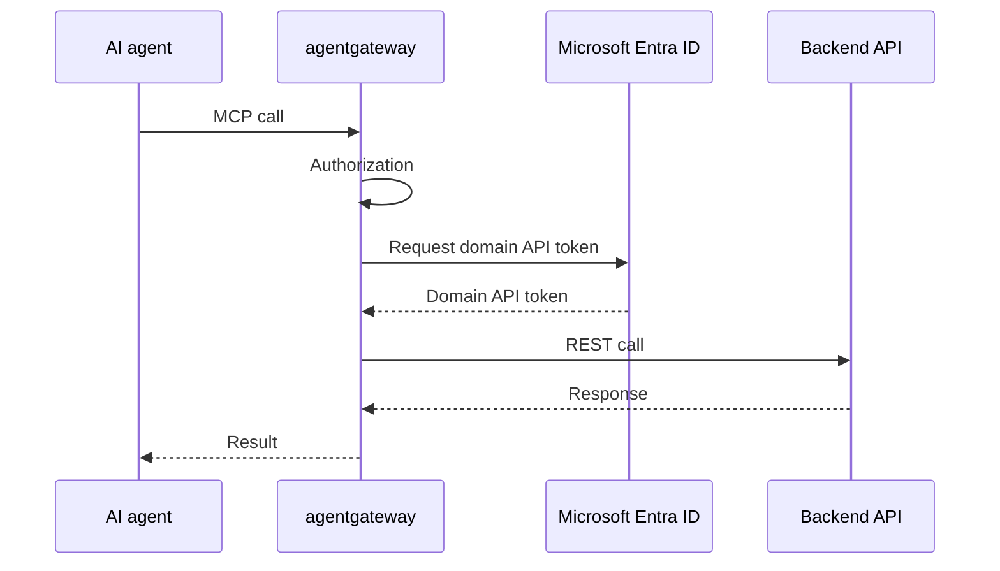
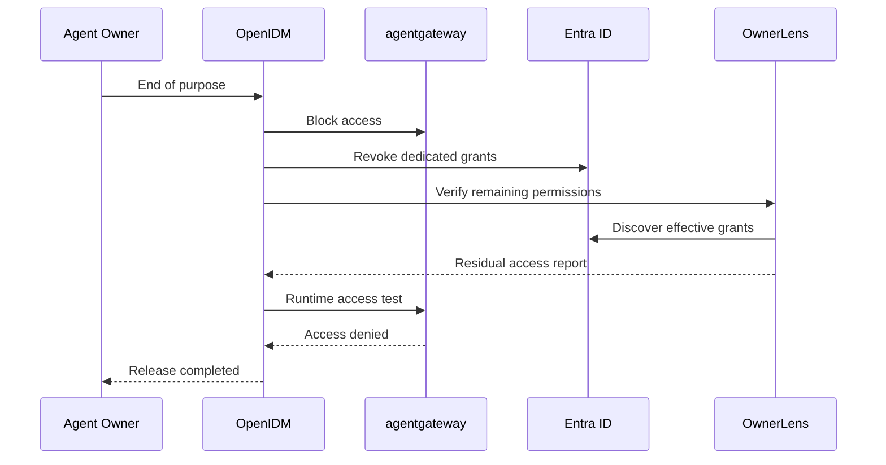

*OwnerLens · OpenIDM · agentgateway · Microsoft Entra ID · Azure*

A valid identity tells an MCP server who is calling. Granting access to an AI agent requires answers to three questions. **Who is accountable for the agent? What is its business purpose? Which actions have been approved?**

KuppingerCole's Bind, Govern, Release (BGR) model defines an agent lifecycle around its approved business purpose. Access remains tied to human accountability, approved purpose and observed execution throughout the lifecycle.

This field note maps BGR to a reference architecture built with open-source components, Microsoft Entra ID and Azure. The design is at the early demonstrator stage.

## 1. Architecture

```mermaid
flowchart TB
    accTitle: Governance architecture
    accDescr: Four planes showing approval through OpenIDM, identity in Entra ID, enforcement through agentgateway, and execution evidence returning to OwnerLens.
    subgraph GOV[Governance Plane]
        O[Agent Owner + Resource Owner] --> I[OpenIDM]
        L[OwnerLens] --> I
        I --> C[OpenICF]
    end
    subgraph ID[Identity Plane]
        E[Microsoft Entra ID]
    end
    subgraph RUN[Runtime Plane]
        direction LR
        A[AI agent] <--> G[agentgateway] <--> B[Backend API]
    end
    subgraph EV[Evidence Plane]
        direction LR
        T[OpenTelemetry / OTLP] --> S[(Blob Storage)]
    end
    C --> G
    E --> A
    G <-->|Domain API token via Managed Identity| E
    G --> T
    S --> L

    style I fill:#372452,stroke:#bd96f2,stroke-width:2px
    style E fill:#163857,stroke:#74b9fa,stroke-width:2px
    style G fill:#163857,stroke:#74b9fa,stroke-width:2px
    style T fill:#4b3218,stroke:#f4b969,stroke-width:2px
    style L fill:#4b3218,stroke:#f4b969,stroke-width:2px
```

- **Governance.** OwnerLens, OpenIDM, OpenICF.
- **Identity.** Microsoft Entra ID.
- **Runtime.** agentgateway and a backend API. The gateway runs on Azure Container Apps Consumption without a dedicated database.
- **Evidence.** OpenTelemetry (OTLP), Blob Storage, OwnerLens.

## 2. Bind — accountability and purpose

- **KC principle.** Establish accountability and approve the purpose before granting access.
- **Implementation.** OwnerLens discovery, OpenIDM approvals, OpenICF policy provisioning.

**No accountable owner. No approved purpose. No effective tool access.**

```mermaid
flowchart TD
    accTitle: Bind, Govern, Release lifecycle
    accDescr: OwnerLens discovery leads to Agent Owner and Resource Owner review before provisioning. Material changes return to the Agent Owner, and the end of the purpose triggers Release.
    D[OwnerLens] --> O[Agent Owner]
    O --> Q[Resource Owner]
    Q --> P[OpenIDM + OpenICF]
    P --> G[GOVERN]
    G -->|Material change| O
    G -->|Purpose ends| R[RELEASE]

    style D fill:#4b3218,stroke:#f4b969,stroke-width:2px
    style P fill:#372452,stroke:#bd96f2,stroke-width:2px
```

## 3. Govern — continuous governance

```mermaid
block-beta
    columns 5
    A["Authorization<br/>OpenIDM + agentgateway"]:2 space C["Credentials & Trust<br/>Entra ID + agentgateway"]:2
    space:5
    space:5
    space:5
    E["Audit<br/>OwnerLens + OTLP"]:2 space R["Active Control<br/>agentgateway + River"]:2
    A <--> C
    A <--> E
    C <--> R
    E <--> R
    A <-.-> R
    C <-.-> E

    style A fill:#372452,stroke:#bd96f2,stroke-width:2px
    style C fill:#163857,stroke:#74b9fa,stroke-width:2px
    style E fill:#4b3218,stroke:#f4b969,stroke-width:2px
    style R fill:#153f33,stroke:#68d3a9,stroke-width:2px
```

*Implementation mapping of KC's four Govern capabilities.*

- **Authorization.** OpenIDM records approved tools and resource scope. agentgateway enforces that scope and denies access by default.
- **Credentials & Trust.** Entra ID issues separate credentials for the agent and for the gateway’s access to the domain API.
- **Active Control.** agentgateway enforces restrictions. River supplies behavioral risk signals.
- **Audit.** OpenTelemetry exports MCP execution events to the evidence pipeline. OwnerLens uses the events retained in Blob Storage.

The agent presents its token to the gateway. The gateway uses its Azure managed identity to obtain a separate app-only token for the domain API.

## 4. Active Control — behavioral risk

The design combines deterministic access controls with behavioral risk assessment. Azure Container Apps Jobs periodically refresh the River model, and the resulting risk signals support governance review.

```mermaid
flowchart TD
    G["agentgateway"] --> T["OpenTelemetry"]
    T --> S[("Blob Storage")]
    S --> R["River<br/>Risk assessment"]
    S --> M["Periodic model refresh"]
    M --> R
    R -->|Suspend access| G
    R -->|Trigger recertification| I["OpenIDM"]
    I --> O["Agent Owner"]
    O --> I
    I -->|Reinstate or revoke| G

    style G fill:#163857,stroke:#74b9fa,stroke-width:2px
    style T fill:#4b3218,stroke:#f4b969,stroke-width:2px
    style R fill:#153f33,stroke:#68d3a9,stroke-width:2px
    style I fill:#372452,stroke:#bd96f2,stroke-width:2px
```

## 5. Release — verified removal of access

*End-to-end Azure deployment, event delivery, per-agent backend identity, River integration and rapid revocation still need validation.*

### **Technology stack**

| Product                                                                                                                                       | Purpose                                                |
| --------------------------------------------------------------------------------------------------------------------------------------------- | ------------------------------------------------------ |
| [OwnerLens Lite](https://github.com/kodevza/ownerlenslite)                                                             | Identity discovery and ownership evidence              |
| [OpenIDM](https://github.com/OpenIdentityPlatform/OpenIDM)                                                             | Governance, lifecycle and approval workflows           |
| [OpenICF](https://github.com/OpenIdentityPlatform/OpenICF)                                                             | Policy provisioning and integration                    |
| [agentgateway](https://github.com/agentgateway/agentgateway)                                                           | MCP gateway and policy enforcement                     |
| [Microsoft Entra ID](https://learn.microsoft.com/en-us/entra/)                                                         | Workload authentication and trust                      |
| [Azure Managed Identity](https://learn.microsoft.com/en-us/entra/identity/managed-identities-azure-resources/overview) | Backend authentication                                 |
| [OpenTelemetry Collector](https://github.com/open-telemetry/opentelemetry-collector)                                   | MCP telemetry and audit evidence                       |
| [River](https://github.com/online-ml/river)                                                                            | Behavioral risk assessment                             |
| [Azure Container Apps](https://azure.microsoft.com/en-us/products/container-apps)                                      | Serverless gateway hosting and periodic model training |
| [Azure Blob Storage](https://azure.microsoft.com/en-us/products/storage/blobs)                                         | Evidence and model persistence                         |
| [Azure Functions](https://azure.microsoft.com/en-us/products/functions)                                                | Example domain API                                     |

### **Governance framework**

[KuppingerCole — Bind, Govern, Release (BGR)](https://www.kuppingercole.com/research/lb81105/bind-govern-release)

*The stack represents the proposed reference architecture, not a fully validated production deployment.*

---

### References

[KuppingerCole BGR](https://www.kuppingercole.com/research/lb81105/bind-govern-release) · [agentgateway](https://agentgateway.dev/docs/standalone/latest/) · [OpenIDM](https://github.com/OpenIdentityPlatform/OpenIDM) · [OpenICF](https://github.com/OpenIdentityPlatform/OpenICF) · [Microsoft Entra Managed Identity](https://learn.microsoft.com/en-us/azure/container-apps/managed-identity) · [OpenTelemetry](https://opentelemetry.io/docs/collector/) · [River](https://github.com/online-ml/river)
