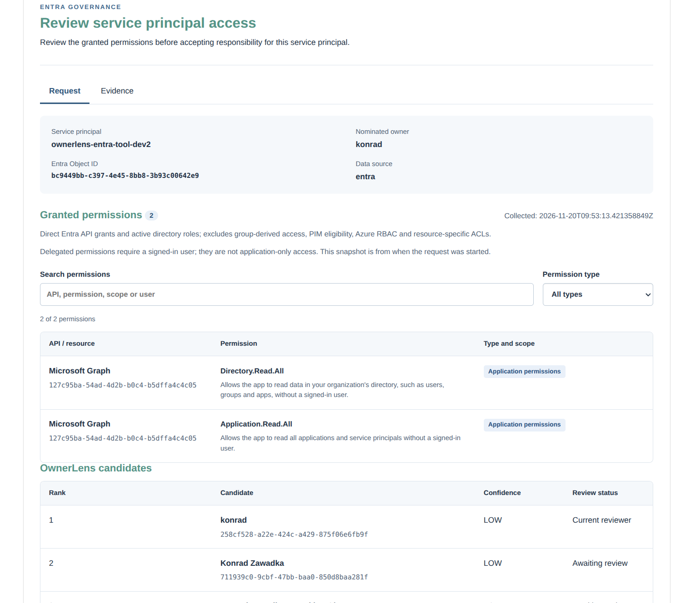
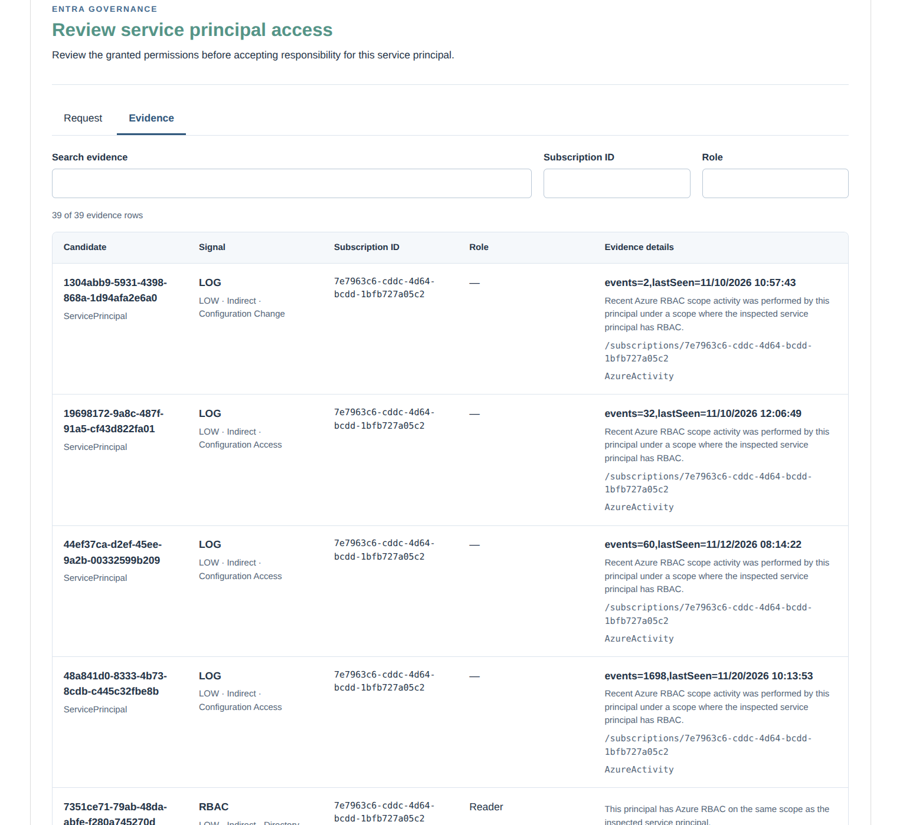

When a Microsoft Entra service principal needs a governance owner, the person asked to take responsibility needs to see why the request reached them. An OwnerLens Lite report can surface candidates and the signals behind them. We wanted that context to stay with the request as it moved from one reviewer to the next.

We integrated OwnerLens Lite with an OpenIDM workflow backed by our Microsoft Entra ID connector for OpenICF. OpenIDM handles task assignment and records the decision. The OwnerLens evidence gives reviewers a way to assess the nomination inside the task they already need to complete.

## Bring Entra identities into OpenIDM

The connector reads Microsoft Graph and Azure role assignments from configured subscriptions. We used OpenIDM reconciliation to bring service principals, directory users and related inventory into managed records. The service principal's Entra object ID identifies the enterprise application under review. User correlation also includes the tenant ID, so the workflow looks for an eligible account in the same directory.

We provisioned local OpenIDM user accounts through reconciliation so an active directory user could be nominated before their first sign-in. When that user signs in through Entra, OpenIDM resolves the existing account and binds the pending task to their verified sign-in identity. This lets the reviewer see the task in Self Service even if the request was created before they ever signed in.

<!-- Add the image beside index.md and uncomment this line:

-->

## Start the review with an OwnerLens report

We export an OwnerLens Lite JSON report for a single enterprise application. The integration's payload helper builds an OpenIDM process start request with the service principal object ID, the request reason and the evidence in `ownerEvidenceJson`. The custom start form also accepts the evidence JSON alongside the selected service principal and the reason.

The workflow resolves candidates by Entra object ID or exact UPN against active synchronized users in the same tenant. Multiple signals for the same person produce one candidate. The strongest confidence band determines the candidate's rank, with report order breaking ties. The first eligible candidate gets the task.

<!-- Add the image beside index.md and uncomment this line:

-->

## Keep the evidence with the active task

The review form has two tabs. **Request** shows the service principal, its granted permissions and the ranked candidates. **Evidence** shows the original signals in a searchable table with filters and separate columns for Azure subscription ID and role. Both tabs offer the decision controls, so a reviewer can act while looking at the relevant signal.

For example, an Azure role assignment can explain why someone is a plausible contact for a workload. The reviewer can check the role and subscription, assess whether their team actually supports that workload, and forward the task to another eligible candidate if appropriate. Evidence that did not resolve to an assignable user stays visible because it can still help the reviewer interpret the nomination.

## Record the decision and carry it forward

The assigned reviewer can accept, decline or forward the request. A decline returns routing to the original ranking and skips candidates who already reviewed the request or are no longer eligible. When the list is exhausted, OpenIDM records that outcome and preserves the current ownership and service principal state.

Acceptance records the reviewer as the local OpenIDM governance owner after checking that the account is still eligible and accounting for any concurrent ownership change. Microsoft Graph ownership remains a separate source of directory evidence. OpenIDM keeps the request snapshot and records who reviewed it, when they acted, what they decided and who received it next.

<!-- Add the image beside index.md and uncomment this line:

-->

Keeping the evidence on the task means the next reviewer can see why the nomination was made even after a handoff. OwnerLens supplies the context for that decision. The workflow records who agreed to take responsibility.
